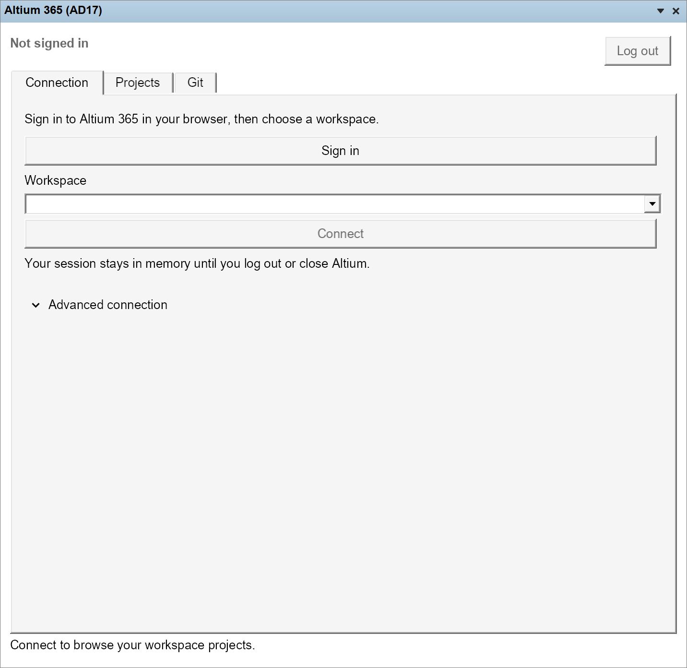

# Altium 17 · Altium 365

An experimental Altium 365 connector for Altium Designer 17, with a dockable workspace panel.

- Browser sign-in with PKCE, workspace discovery and token refresh.
- Connect using a workspace API access token.
- List workspace projects with paging and Git availability.
- Clone, inspect changes, commit selected files, pull and push Altium-hosted Git projects.
- **Save to Server** appears for changed project files, unsaved editor documents or commits waiting to upload, with a file review and comment dialog.
- Direct Git access with a repository URL and Workspace token, without GraphQL project discovery.

**Status:** the original panel loads in AD17 under Wine. Authentication and paging pass mocked tests; live API TLS connectivity is verified. The Git workflow and Save to Server engine are tested against local repositories using real Git. Authenticated Altium 365 access, the new Git UI, native Save to Server menu/dialog and project opening still need live testing. Managed-component integration is future work.



## Install

Close AD17, run [Altium-17-365-Setup.exe](https://github.com/lazy-jubei/Altium-17-365/releases/download/v0.1.0/Altium-17-365-Setup.exe), then restart. Open **System → Altium 365 (AD17)** from the bottom-right panel menu. Requires .NET Framework 4.8.

The published v0.1.0 installer contains workspace browsing only. Build the source below for Git and Save to Server.

Enter your workspace address and workspace API access token, or expand **Browser sign-in** and enter an Altium-registered public client ID. Browser login requires [application registration with Altium](https://altiumdeveloper.github.io/altium-auth/guides/register-your-application/); an existing AD26/browser login is not automatically transferred. Tokens stay in memory. Nonsecret connection and Git preferences are saved locally.

## Git workflow

Install [Git for Windows](https://gitforwindows.org/), or use MinGit, in the Windows environment running AD17. Under Wine, use Windows `git.exe`; the macOS Git executable cannot be launched as a Windows process. The panel finds standard Git installations and `%LOCALAPPDATA%\Altium17365\MinGit\cmd\git.exe`, or you can select an executable under **Git installation**. Git 2.31 or later is required for process-local authentication configuration.

1. In **Projects**, select a project and choose **Use selected project**. Alternatively, open **Git** and enter the repository URL and a Workspace access token directly. Direct Git does not need GraphQL project listing or this connector's OAuth client registration, but still requires a valid token and permission to access the project.
2. Choose a new or empty local folder and **Clone**, or choose an existing working copy and **Refresh status**. Existing working copies must have matching `origin` fetch and push URLs. Use the repository URL exactly as returned by Altium or copied from the project's existing Git remote.
3. Choose **Open project** and select its `.PrjPcb` file. The connector opens it with the same AD17 executable running the panel.
4. Edit the project. The panel monitors saved files, AD17's unsaved-document flags and local commits waiting to upload. Choose **Save to Server…** in the Git tab or the active document's **File** menu. It saves modified open documents inside this working copy, then shows the changed files and a comment field. Choose the files and select **Save to Server** to commit and push to `master`. Unchecked files remain local, including files already staged by another Git client. Configure `user.name` and `user.email` using your Git client if they are not already set.
5. If uploading fails, the local commit is retained and **Save to Server…** stays available. Update credentials or resolve the connection problem and retry; an upload retry does not create a second commit. **Commit selected** and **Push** are also available as separate actions.
6. Before **Pull**, save and close the working copy's documents in Altium. Pull requires a clean working copy and only fast-forwards; review diverged histories with an external Git client. Save to Server also refuses unresolved merge conflicts.

Change monitoring only reads local state. Pending-commit counts use the last known `origin/master`; server conflicts are checked by the push. No uploads run automatically. If a native document save is cancelled or fails, the upload does not start. Document saves are limited to the configured working-copy folder.

Workspace tokens authenticate Git using HTTP Basic authentication (`token` as the username and the access token as the password). The panel supplies a repository-scoped header through the Git process environment, with credential helpers and redirects disabled. It does not put credentials in command arguments, repository URLs, Git config or saved preferences. A project selected through an OAuth connection uses its refreshed Workspace token; replace an expired manually supplied token yourself. **Disconnect / clear token** clears the session and direct Git token.

Repository URLs, folder paths and your Git executable preference are saved locally. This synchronizes project source files; it does not implement cloud releases, managed components or conversion of newer document formats. See Altium's [Project Git Access](https://www.altium.com/documentation/altium-developer-center/altium-365/key-concepts/project-git-access) documentation.

## Build

.NET SDK 8+ and an AD17 installation containing the SDK assemblies:

```powershell
./Build.ps1 -AltiumInstallDir 'C:\Program Files (x86)\Altium\AD17'
```

On macOS: `bash tools/build-macos.sh`; then `python3 tools/deploy-wine.py` with AD17 closed. Run tests with `dotnet run --project tests/WorkspaceTests.csproj -f net8.0` and `dotnet run --project tests/InstallerTests.csproj`.

Uses Altium's [authentication library](https://github.com/AltiumDeveloper/altium-auth) and [Altium 365 API](https://www.altium.com/documentation/altium-developer-center/altium-365/api).
