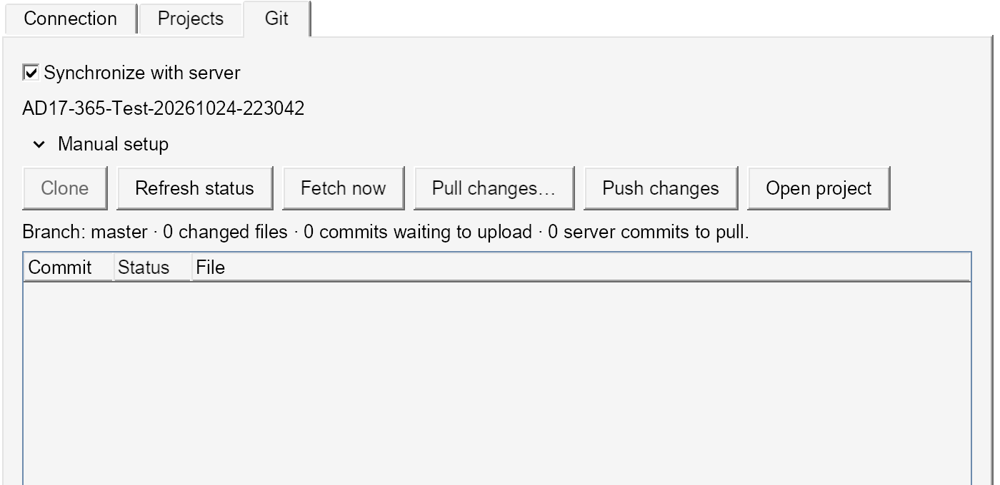

# Altium 17 · Altium 365

A dockable Altium 365 panel for Altium Designer 17.

- Detects the active project's Altium 365 working copy automatically.
- Browser sign-in, project creation/search, token refresh and logout.
- Pull/push changes with Local or Server choices for conflicting files. **Save to Server** combines commit and push.
- Background fetch for open projects every two minutes; cancellable Git processes.



## Install

Download [v0.6.1 setup](https://github.com/lazy-jubei/Altium-17-365/releases/download/v0.6.1/Altium-17-365-Setup.exe). Close AD17, run the installer and restart. Includes portable Git; no separate Git installation is needed. Requires .NET Framework 4.8.

## Connect

Open **System → Altium 365 (AD17)**, choose **Sign in**, then select your workspace. **Log out** in the header clears the session and Git credentials. Sessions stay in memory; addresses and Git preferences are saved locally.

Open an existing Altium 365 project in AD17; **Synchronize with server** detects it automatically. For a new clone, choose **Projects → Use selected project**, then **Manual setup**. [Git workflow](docs/GIT.md).

## Build

.NET SDK 8+ and the AD17 SDK assemblies:

```powershell
./Build.ps1 -AltiumInstallDir 'C:\Program Files (x86)\Altium\AD17'
```

On macOS: `bash tools/build-macos.sh`, then `python3 tools/deploy-wine.py` with AD17 closed. Builds download a pinned, checksum-verified MinGit archive; setup installs it offline.

Authentication uses Altium's [library](https://github.com/AltiumDeveloper/altium-auth) and the public browser flow from its [VS Code extension](https://marketplace.visualstudio.com/items?itemName=altium.developer). VS Code is not required.

**Tested:** AD17 17.1 under Wine: sign-in, project creation, clone, pull and uploads. Managed components remain unverified; newer document features may not survive an AD17 save. [Verification notes](docs/TESTING.md).
