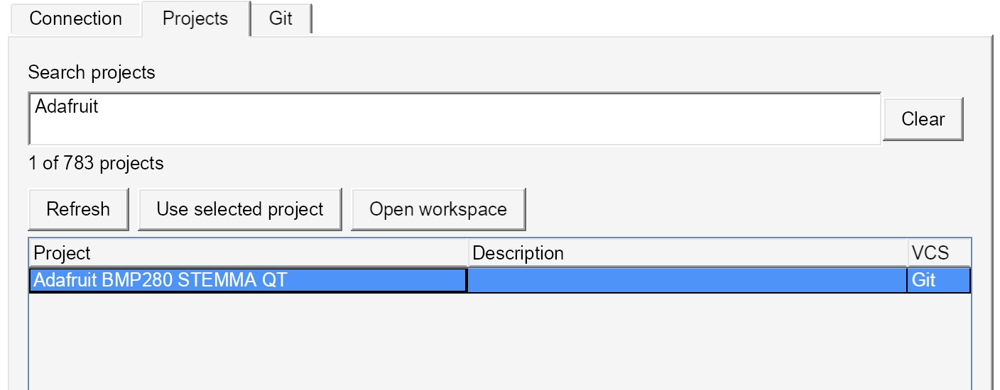

# Altium 17 · Altium 365

A dockable Altium 365 panel for Altium Designer 17.

- Browser sign-in, workspace selection and automatic token refresh.
- All workspace projects, with search by name or description and a logout button.
- Clone, pull, review changes, commit and push. **Save to Server** lets you review files and add a comment.
- Git runs in separate background processes with cancellation.



## Install

Download [v0.2.0 setup](https://github.com/lazy-jubei/Altium-17-365/releases/download/v0.2.0/Altium-17-365-Setup.exe). Close AD17, run the installer and restart. Requires .NET Framework 4.8 and [Git for Windows](https://gitforwindows.org/); Wine needs Windows `git.exe`.

## Connect

Open **System → Altium 365 (AD17)**, choose **Sign in**, then select your workspace. **Log out** in the header clears the session and Git credentials. Sessions stay in memory; addresses and Git preferences are saved locally.

In **Projects**, choose **Use selected project**, then select a working-copy folder in **Git** to clone or refresh. An existing checkout can optionally speed up cloning. [Git workflow](docs/GIT.md).

## Build

.NET SDK 8+ and the AD17 SDK assemblies:

```powershell
./Build.ps1 -AltiumInstallDir 'C:\Program Files (x86)\Altium\AD17'
```

On macOS: `bash tools/build-macos.sh`, then `python3 tools/deploy-wine.py` with AD17 closed.

Authentication uses Altium's [library](https://github.com/AltiumDeveloper/altium-auth) and the public browser flow from its [VS Code extension](https://github.com/altium/a365-vscode-extension). VS Code is not required.

**Tested:** AD17 17.1 under Wine: browser sign-in, project browsing, clone and pull. Cloud uploads and managed components remain unverified; newer document features may not survive an AD17 save. [Verification notes](docs/TESTING.md).
